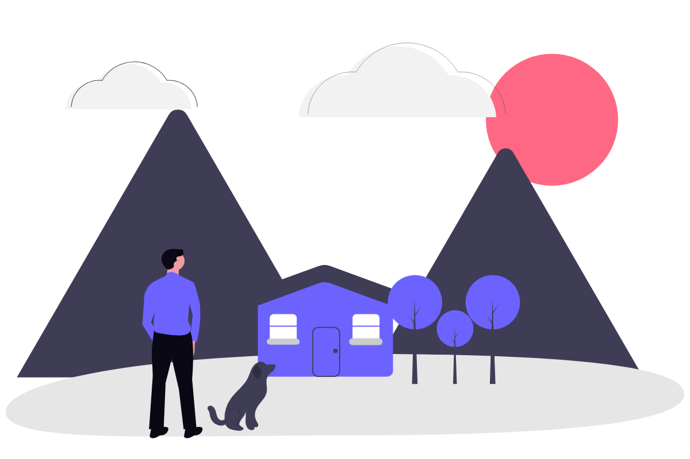

# Конструктор векторных композиций

Веб-сервис, который разбирает 20 SVG-иллюстраций в едином стиле на компоненты (персонажи, предметы, декор) и собирает из них новые сцены на холсте. Экспорт — чистый векторный SVG. Сервис ничего не генерирует: любая композиция состоит только из фигур исходных иллюстраций.

- **Сервис:** _ссылка на Vercel — см. раздел «Деплой»_
- **Демо-видео:** [examples/demo.webm](examples/demo.webm) (≈1 мин, демо-сценарий целиком)
- **Примеры композиций:** [examples/](examples/)


## Запуск

```bash
npm install
npm run dev        # http://localhost:5173
npm run build      # tsc (strict) + vite build → dist/
```

Стек: Vite + React 19 + TypeScript (strict) + Tailwind 4, Zustand, `idb-keyval`. Бэкенда нет.

## Демо-сценарий

1. Слева выбрать исходник, например **02 «Игра с собакой»**. Он откроется в режиме выделения.
2. Обвести персонажа рамкой: выделятся все фигуры, которые целиком попали внутрь. Справа сразу видно превью будущего компонента.
3. Ввести название и нажать **«Сохранить в библиотеку»** (или `Enter`).
4. Повторить для других исходников (07, 11, 05…), затем вернуться к холсту («← Холст» или `Esc`).
5. Перетащить компоненты из библиотеки на холст или кликнуть по карточке. Расставить, масштабировать, повернуть.
6. Нажать **«Скачать SVG»**.

| Режим выделения | Холст |
| --- | --- |
| Рамка — фигуры целиком внутри · `Shift`+рамка — добавить · `Alt`+рамка — вычесть | Клик — выбрать, перетаскивание — переместить |
| Клик — самая глубокая фигура под курсором · `Shift`+клик — добавить/убрать | Угловые ручки — масштаб от центра (пропорционально, `Shift` — свободно) |
| `↑` — расширить до родительской группы (кроме корневой обертки) | Ручка над рамкой — поворот (`Shift` — шаг 15°) |
| `Ctrl+A` — все фигуры, `Esc` — снять выделение / к холсту | `Ctrl/⌘+D` — дубликат, `Delete` — удалить, стрелки — 1px, `Shift`+стрелки — 10px |
| Наведение подсвечивает фигуру, выделенные обведены, общая рамка — пунктиром | `Ctrl/⌘+Z` / `Ctrl/⌘+Shift+Z` — undo/redo (100 шагов), пробел или колесо — панорама, `Ctrl`+колесо — зум |

Порядок слоев меняется кнопками (на передний план / вперед / назад / на задний план) и перетаскиванием в панели «Слои».

**Контекстное меню (ПКМ)** открывается у курсора:

- на объекте холста или строке в панели «Слои» — дублировать, отразить, порядок слоев (недоступные пункты неактивны), удалить;
- на карточке библиотеки — добавить на холст, переименовать, удалить;
- в режиме выделения на фигуре — выделить её, добавить к выделению или исключить из него, выделить только её, выделить её группу. Фигура, по которой открыто меню, подсвечена;
- в режиме выделения в любом месте — выделить все, инвертировать выделение, расширить до группы, снять выделение, сохранить в библиотеку.

Меню закрывается кликом мимо, `Esc` или колесом. Пункты можно выбирать стрелками и `Enter`. Отражение по горизонтали — кнопкой на панели. Размер артборда задается в верхней панели (по умолчанию 1200×800).

## Исходные иллюстрации и лицензия

`public/sources/01.svg … 20.svg` и `manifest.json` (`id`, `title`, `file`, `originalName`).

- **01–19** — [unDraw](https://undraw.co) (автор — Katerina Limpitsouni). Лицензия unDraw разрешает бесплатное коммерческое и личное использование без указания авторства.
- **20 «Кардиограмма»** — иконка с [SVG Repo](https://www.svgrepo.com) (`electrocardiogram-svgrepo-com.svg`), не из unDraw. В примерах не используется.

Файлы лежат как есть, без ручной подготовки. Опциональный `scripts/normalize.ts` (SVGO) не понадобился: самопроверка ниже показывает, что извлечение из исходных файлов совпадает с оригиналом попиксельно.

## Архитектура

```
src/
  types.ts               модели Component, SceneObject, Scene
  lib/matrix.ts          аффинные матрицы 2D, форматирование transform
  lib/extract.ts         разбор исходника и извлечение компонента
  lib/transform.ts       objectTransform(): одна функция для холста и экспорта
  lib/exportSvg.ts       сборка итогового SVG, общий <defs>
  lib/svg.ts             сериализация, поиск и переписывание ссылок url(#id)/href
  lib/storage.ts         IndexedDB (idb-keyval)
  store/scene.ts         сцена, выделение, история undo/redo (Zustand)
  store/library.ts       библиотека компонентов
  components/extract/    режим выделения
  components/canvas/     холст, ручки, панель слоев, тулбар
  components/ContextMenu.tsx  контекстное меню у курсора
scripts/verify-extraction.mjs   самопроверка извлечения (70 случаев)
scripts/demo.mjs                сквозной сценарий через UI, примеры, проверки чек-листа, запись видео
```

### Хранение

IndexedDB через `idb-keyval`, отдельная база `svg-constructor`, два ключа:

- `components` — массив `Component`;
- `scene` — `Scene`: размер артборда и массив `SceneObject`. Порядок массива — порядок слоев.

```ts
type Component = { id; name; sourceId; width; height; defs; markup; createdAt }
type SceneObject = { id; componentId; x; y; scale; scaleY; rotation; flipX }
type Scene = { width; height; objects: SceneObject[] }
```

Отличие от модели из ТЗ — поле `scaleY`. Масштаб с `Shift` непропорциональный, а одним числом `scale` его не выразить. При пропорциональном масштабе `scaleY` меняется вместе с `scale`. Старые записи без `scaleY` читаются как `scaleY = scale`.

Сцена сохраняется после каждого шага истории. Во время жеста (перетаскивание, масштаб, поворот) промежуточные кадры не пишутся, сохраняется только итог. Библиотека сохраняется при каждом изменении. При загрузке объекты, чьих компонентов уже нет, отбрасываются.

### Извлечение (`src/lib/extract.ts`)

Исходник загружается `fetch`-ем, парсится `DOMParser` и вставляется **инлайном** в DOM. Только так работают клики, `getBBox`, `getComputedStyle` и геометрия путей.

**Разбор (`analyzeSource`).** Для каждой фигуры (`path, circle, ellipse, rect, polygon, polyline, line` вне `defs`/`clipPath`/…) считаются:

- **матрица предков** — произведение `transform` всех групп от фигуры до корня, включая корневую обертку `<g transform="translate(...)">`. Списки трансформаций читаются через `transform.baseVal` поэлементно. `consolidate()` не используется, потому что он переписывает атрибут в исходнике;
- **матрица фигуры** = матрица предков × собственный `transform`;
- **bbox в координатах корня.** `getBBox()` дает рамку в локальных координатах. Если матрица без поворота, достаточно перенести четыре угла — это точно. Если фигура повернута (matrix в 02, `rotate` в 10), углы локального bbox дают завышенную рамку, поэтому контур семплируется через `getPointAtLength` и каждая точка переводится матрицей. Обводка добавляет `stroke-width / 2 × масштаб`.

**Выделение.** Рамка выбирает фигуры, чей bbox в координатах корня целиком внутри (`Shift` — объединение, `Alt` — вычитание). Клик берет `event.target`: это всегда самая глубокая отрисованная фигура, а не обертка. `↑` находит наименьшую общую группу выделенных фигур и поднимается, пока в группе есть невыделенные фигуры. Корень и корневая обертка не считаются.

**Сохранение (`extractComponent`):**

1. **Геометрия.** Клон каждой фигуры сохраняет свой `transform` и кладется в `<g transform="matrix(...)">` с матрицей предков. Соседние фигуры с одинаковой матрицей делят одну обертку, поэтому у unDraw компонент обычно состоит из одной группы.
2. **Порядок.** Фигуры идут по порядку документа (индекс при разборе), а не по порядку клика.
3. **Границы.** Общий bbox выделения с учетом обводки округляется наружу до 0,001. В матрицы оберток добавляется сдвиг `translate(-x, -y)`, так что компонент начинается в (0,0). `width`/`height` сохраняются.
4. **Цвета.** Наследуемые свойства (`fill`, `stroke`, `*-opacity`, `stroke-width`, `fill-rule`, …), которые фигура получила от группы, записываются в клон вычисленным значением (`getComputedStyle`; `url(...)` нормализуется в `url(#id)`). `opacity` не наследуется в CSS, поэтому прозрачность групп-предков перемножается и записывается в фигуру.
5. **Defs.** В клонах ищутся ссылки `url(#id)` (в любых атрибутах, включая `style`) и `href`/`xlink:href="#id"`. Найденные элементы рекурсивно проверяются на свои ссылки (градиент → `href` → градиент). Зависимости копируются в порядке документа.
6. **Id.** Все id в defs получают префикс `c<shortid>-`, ссылки переписываются по карте. Id у самих фигур удаляются: на них никто не ссылается, а у нескольких экземпляров они бы дублировались.
7. Разметка сериализуется `XMLSerializer` без повторяющихся `xmlns`. Пространства имен объявляются один раз на корневом `<svg>` превью и экспорта. Результат — `Component` в IndexedDB.

Живое превью в режиме выделения — тот же `extractComponent` с временным префиксом, показанный через ``. Превью в библиотеке тоже ``: id внутри изолированы и не пересекаются с холстом.

### Переиспользование

- Экземпляр на холсте — это `SceneObject` со ссылкой на `componentId`. Разметку он не копирует.
- **Одна функция трансформации** `objectTransform()` (`src/lib/transform.ts`) используется и на холсте, и в экспорте:
  `translate(x + cx, y + cy) rotate(rotation) scale(flipX ? -scale : scale, scaleY) translate(-cx, -cy)`, где `cx, cy` — центр компонента. Поэтому холст и файл совпадают.
- **Общий `<defs>` по компонентам.** Defs каждого использованного компонента подключаются ровно один раз (по `componentId`) — и в `<defs>` холста, и в `<defs>` экспорта. Id уже уникальны на уровне компонента (`c<shortid>-…`). Поэтому два экземпляра одного компонента ссылаются на одни и те же градиенты без конфликтов, а экземпляры разных компонентов не пересекаются.
- **Экспорт — простая сериализация:** `<svg viewBox="0 0 W H">`, `<defs>`, белый фон `<rect id="background">`, затем по группе `<g id="obj-…" data-component="…" data-name="…" transform="…">` на объект в порядке слоев. Растра и base64 нет.

### Холст

Собственный редактор на SVG. Панорама и зум меняют `viewBox`, координаты указателя переводятся в координаты артборда через `getScreenCTM()`. Разметка компонента вставляется через `innerHTML` в мемоизированную группу и при перемещении не перепарсивается.

**Ручки.** Рамка рисуется по видимому прямоугольнику объекта: центр, полуразмеры `w/2·scale`, `h/2·scaleY`, угол. Поэтому у повернутого объекта рамка повернута вместе с ним. При масштабе указатель переводится в локальные координаты объекта (поворот снимается), и новый масштаб — это проекция на диагональ угла. Масштаб идет от центра, а центр (`x + cx, y + cy`) от масштаба и поворота не зависит, так что объект не уплывает. Это проверяется автоматически.

**История.** Хранятся снимки сцены (immutable), максимум 100. Жест — один шаг. Серия сдвигов стрелками склеивается в один шаг. При удалении компонента его экземпляры убираются из сцены и из всей истории, поэтому undo не может вернуть «битый» объект.

## Проверки

Обе проверки запускаются при работающем `npm run dev`.

**`node scripts/verify-extraction.mjs` — точность извлечения, 70 случаев.** Для каждого из 20 исходников извлекаются наборы фигур: все, четные, нечетные, только повернутые, только с градиентом. Компонент рендерится и сравнивается попиксельно с оригиналом, в котором оставлены только выбранные фигуры. Дополнительно проверяется, что ничего из оригинала не выходит за bbox компонента (компонент не обрезан) и что все id и ссылки префиксованы. Результат: **0 отличающихся пикселей во всех 70 случаях**, включая matrix-поворот в 02 и градиенты в 07, 11, 17.

**`node scripts/demo.mjs` — сквозной сценарий через UI, 49 проверок.** Через настоящий интерфейс (рамки, Alt-вычитание, drag & drop, ручки) извлекаются 17 компонентов, собираются три композиции и экспортируются в `examples/`. Затем проверяется чек-лист:

- холст и экспорт совпадают попиксельно;
- сцена и библиотека переживают перезагрузку;
- 32 шага undo/redo;
- компоненты с градиентами из 07, 11 и 17 — по два экземпляра одновременно;
- поворот на 45° и масштаб угловой ручкой: смещение центра 0,000;
- порядок слоев совпадает в панели и в экспорте;
- удаление используемого компонента;
- контекстное меню на холсте, в слоях, в библиотеке и в исходнике: открывается у курсора, не выходит за край окна, действия применяются;
- в экспорте нет `<image>`/base64, все id уникальны.

`node scripts/demo.mjs --video` записывает демо-видео. `EXAMPLES_DIR=<папка>` перенаправляет вывод, чтобы не перезаписывать `examples/`.

## Примеры

Все три собраны из элементов 3+ исходников через UI; SVG и PNG-превью лежат в `examples/`.

| | |
| --- | --- |
| **Вечерний фудтрак** — 14, 05, 16, 11, 02 |  |
| **Домик в горах** — 04, 14, 05, 07 |  |
| **Вечер с аналитикой** — 05, 07, 16, 17, 02 |  |

## Ограничения и что можно улучшить

- Извлекаются только геометрические фигуры. `<use>`, `<text>` и `<image>` не поддерживаются (в наборе их нет).
- `clip-path`, `mask` и `filter` на группах-предках не переносятся (в наборе их нет). Нужно либо переносить их на обертку, либо предупреждать при выделении.
- Прозрачность группы переносится умножением в каждую фигуру. Для перекрывающихся полупрозрачных фигур это немного отличается от групповой прозрачности. В наборе это не проявилось: расхождение 0 пикселей.
- На холсте выделяется один объект. Нет мультивыделения, группировки, привязок и направляющих.
- История не сохраняется между перезагрузками (сохраняется сама сцена).
- Библиотека хранится одним массивом в IndexedDB. Для сотен компонентов лучше хранить по ключу на компонент.
- Мелкие фигуры удобнее выделять с увеличением (кнопки зума в режиме выделения).
- Интерфейс рассчитан на десктоп; на тач-устройствах не оптимизирован.

## Деплой

Проект статический, `vercel.json` уже настроен (framework `vite`, output `dist`):

```bash
npx vercel          # первый раз — вход и привязка проекта
npx vercel --prod
```

Либо импортировать репозиторий в Vercel: настройки определятся автоматически.

## AI-инструменты

- **Claude Code** (модель Claude Opus 5.5): разработка кода, скрипты проверки и записи демо, README.
