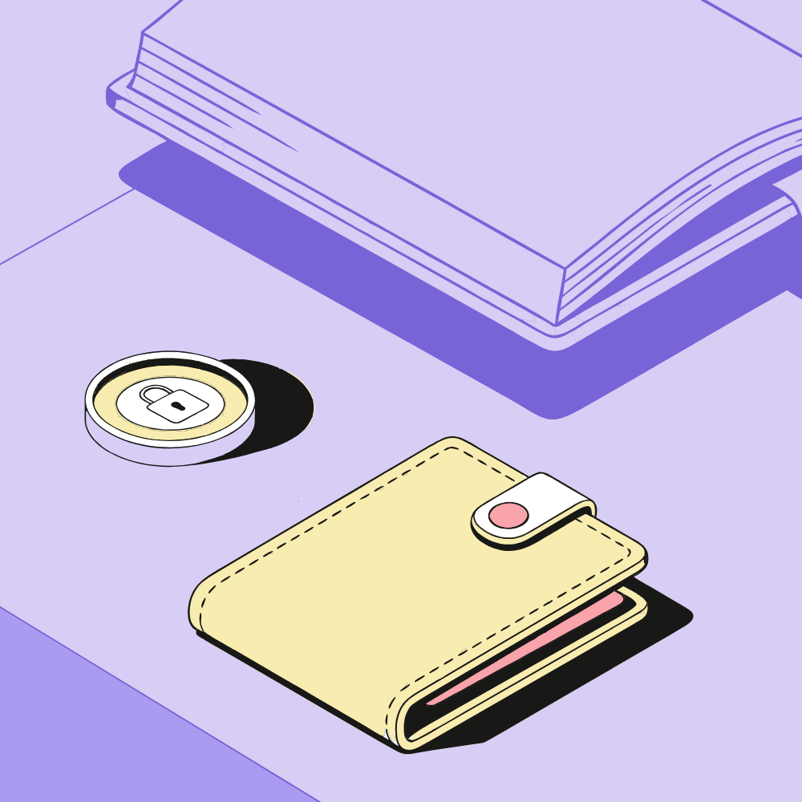
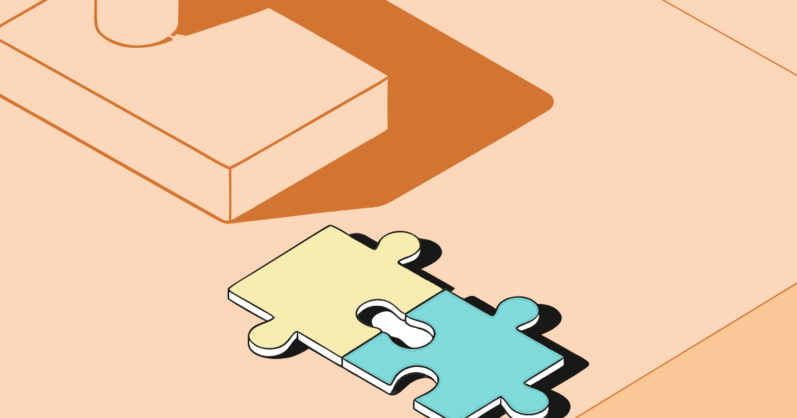

# Конструктор векторных композиций

Веб-сервис автоматически собирает композиции из готовых объектов иллюстраций. Собрать можно двумя способами:

- по метафоре или названию («финансовая грамотность»);
- по списку объектов («наушники, телефон»).

Объекты не генерируются и не меняются: сервис только ставит их в кадр, выбирает состояние (основной или фоновый вариант) и перекрашивает строго в цвета выбранной схемы. Результат — редактируемый SVG, который можно сразу вставить в Figma.

- **Сервис:** https://svg-compositions.vercel.app
- **Репозиторий:** https://github.com/22lalki/svg-compositions
- **Примеры композиций:** [examples/](examples/) (`compose-*.svg`, `compose-*.png`)



## Запуск

```bash
npm install
npm run dev        # http://localhost:5173
npm run build      # tsc (strict) + vite build → dist/
```

Стек: Vite + React 19 + TypeScript (strict) + Tailwind 4, Zustand, `idb-keyval`. Бэкенда нет. `@anthropic-ai/sdk` — только для необязательного режима ИИ; он загружается при первом запросе к модели.

## Как пользоваться

Сервис открывается на вкладке **«Композиции»**. При первом визите на холсте уже собран пример «Финансовая грамотность».

**Сценарий 1 — по метафоре.** Слева, на вкладке «По метафоре», ввести фразу и нажать **«Собрать»** (или `Enter`). Под кнопкой видно, какие слова привели к каким объектам. Примеры:

- «Финансовая грамотность» → Монета, Кошелек, Книга;
- «Идея для стартапа» → Лампа + Пазлы.

Готовые фразы-примеры можно выбрать кликом.

**Сценарий 2 — по объектам.** На вкладке «По объектам» перечислить названия («наушники, телефон») и/или отметить объекты кликом по карточкам в наборе, затем нажать **«Собрать»**. Отметка сразу открывает эту вкладку, а над набором появляется полоска «Отмечено: N» с кнопками «Собрать» (из отмеченных) и «Сбросить». «+» на карточке или перетаскивание добавляют объект на холст без пересборки.

**«Другой»** — следующий вариант. В сценарии «по метафоре» он чередует и наборы объектов, и раскладки: для «финансовой грамотности» это монета + книга + кошелек, монета + папка, монета + книга и т. д., пояснение под кнопкой показывает текущий набор. На вкладке «По метафоре» карточки набора не отмечаются — объекты подбираются сами; «+» и перетаскивание работают на обеих вкладках.

| Холст | Панель справа |
| --- | --- |
| Клик — выбрать, `Shift`+клик или рамка — несколько, перетаскивание — переместить | **Размер:** L (1000×1000, 1200×630, 800×1200) или S (вдвое меньше: 500×500, 600×315, 400×600) |
| Ручка над рамкой — поворот (`Shift` — шаг 15°), `R` / `Shift+R` — ±15° | **Формат:** квадрат, горизонталь, вертикаль |
| `Ctrl+D` — дублировать, `Delete` — удалить, стрелки — 1px (`Shift` — 10px) | **Цветовая схема:** 3 встроенные; своя — палитра SVG или HEX с любым числом цветов |
| `Ctrl+G` — объединить, `Ctrl+Shift+G` — разъединить; группа выделяется и двигается целиком | **Фон:** круги, клин или без декора; декор можно отразить |
| `Ctrl+]` / `Ctrl+[` — слой вперед/назад, с `Shift` — на передний/задний план | **Объект:** основной/фоновый, поворот, цвета по ролям схемы |
| Правый клик — меню объекта; объекты из набора можно перетащить на холст | **Слои:** порядок перетаскиванием, группы подписаны |
| `Ctrl+Z` / `Ctrl+Shift+Z` — отмена/повтор (100 шагов) | |

**Экспорт.** Есть два способа:

- **«SVG»** скачивает файл;
- **«Для Figma»** копирует тот же SVG в буфер, и в Figma он вставляется через `Ctrl+V` редактируемыми слоями.

В файле фон и каждый объект — отдельные именованные группы («Фон», «Монета», «Кошелек»), объединенные объекты лежат во вложенной группе. Внутри только контуры, без растра. Кадр обрезает выступающие объекты, как в примерах дизайнера.

**Своя библиотека объектов.** Кнопки над набором — «загрузить файлы» и «загрузить папку» (или просто перетащить SVG в окно). Файлы раскладываются по тем же правилам, что у набора:

- `Книга.svg` и `Книга (1).svg` — варианты одного объекта;
- основной или фоновый вариант определяется по цветам;
- размер берется из подпапки `L/` или `S/`, а если подпапок нет — больший вариант считается L.

Цвета файла приводятся к ролям схемы, иначе объект нельзя было бы перекрашивать. Правый клик по своему объекту позволяет задать название и ассоциации для метафор.

**ИИ для метафор (по желанию).** «ИИ: выкл» под кнопкой «Собрать» → ввести свой ключ Claude API. Тогда фразу разбирает модель `claude-opus-5-5` и выбирает 2–3 объекта из набора. Она понимает и сложные формулировки: «путь от идеи до прибыли» → Лампа, Монета.

- Ключ хранится только в этом браузере, запрос идет напрямую в API Anthropic. Сервер сервиса ключа не видит — сервера нет.
- Без ключа, при ошибке или отказе модели работает встроенный словарь, и сообщение об этом показывается пользователю.

## Правила набора и как они соблюдаются

| Правило из ТЗ | Как сделано |
| --- | --- |
| Объект нельзя менять, только копировать | Файл объекта вставляется как есть. Меняются только цвет заливки по ролям и трансформация `translate` + `rotate` |
| Нельзя менять пропорции | Масштаба нет ни на холсте, ни в экспорте: объекты всегда в натуральную величину выбранного размера |
| Размеры L и S | Переключатель размера подменяет все объекты и фон вариантами нужного размера. Позиции масштабируются вдвое, композиция сохраняется |
| Основной и фоновый объекты | Состояние — это выбор файла: цветной или монохромный вариант. Переключается в панели «Объект» и в меню |
| Цвета схемы | Каждый цвет файла объекта — роль: фон светлый/средний/темный, черный, акценты 1–3, белый. Роль ложится на цвет палитры: светлый фон — на первый цвет фона, темный — на последний, акценты — на цвета объектов по порядку. Вручную можно выбрать любой цвет палитры, других цветов взять неоткуда |
| В фоне — только цвета фона | Фоновому объекту и декору доступны только фоновые цвета и белый. Акценты и черный в палитре объекта неактивны, а проверка в тулбаре («Схема соблюдена») показывает нарушения, если они появятся |
| Свои схемы | Палитра SVG с любым числом цветов: две колонки (слева фон, справа объекты) или два ряда (сверху фон). Другая раскладка (один ряд, сетка) тоже принимается: светлые приглушенные цвета идут в фон, яркие и темные — в объекты, и это можно поправить правым кликом по схеме («Изменить цвета»). Если цвет фона в схеме один, фоновый объект слился бы с фоном — автосборка оставляет объекты основными. Черный и белый узнаются по значению в любой колонке, а если их нет — берутся самый темный цвет палитры и самый светлый цвет фона. Можно ввести HEX двумя группами: «фон \| объекты». Палитры набора лежат в `public/set/palettes/` как образец |

## Как устроена автосборка

**Раскладки взяты из примеров дизайнера.** Дизайнер прислал 6 композиций в трех форматах (18 SVG). Скрипт `scripts/build-set.mjs` находит в каждом примере объекты набора, сопоставляя габариты их контуров: каждый контур объекта голосует за сдвиг, побеждает большинство. Скрипт выяснил три вещи:

- объекты стоят в натуральную величину L и только сдвинуты (без поворота и масштаба);
- между форматами объекты перекладываются независимо, это не общий сдвиг;
- в композиции 5 дизайнер перекрасил кошелек.

Из этого получились 6 шаблонов × 3 формата. У каждой ячейки шаблона есть позиция, состояние, порядок слоев и перекраска.

**Кандидаты.** Объекты пользователя распределяются по ячейкам каждого шаблона так, чтобы размер был ближе всего к исходному: крупный — в ячейку крупного, мелкий — мелкого. Позиция в чужой ячейке сохраняет привязку к краю кадра:

- исходный объект уходил за левый край — новый ставится по правому краю ячейки;
- уходил за правый — по левому;
- иначе по центру.

К кандидатам добавляются их зеркальные варианты и варианты состояний: фоновым по очереди становится каждый объект (и мелкий, например ручка), плюс вариант «все основные». Если в кадре несколько крупных основных объектов, добавляются и варианты, где лишние становятся фоновыми и уходят под остальные: у дизайнера крупный основной объект всегда один, а менять состояние объекта ТЗ разрешает.

**Оценка по формам объектов** (`aesthetics.ts`). Объекты в изометрии вытянуты по диагонали: их рамки перекрываются там, где сами объекты не касаются. Поэтому для каждого объекта строится маска реальной формы (сетка 16 px), и раскладка оценивается по ней. Нормы взяты из 18 примеров дизайнера — примеры укладываются в них, кроме одного касания горшка наушниками (точная раскладка дизайнера все равно эталон и идет первой):

| Что проверяется | Норма из примеров |
| --- | --- |
| Небольшой основной объект | виден минимум на 75% и ничем не закрыт — он лежит сверху |
| На что можно класть | только на крупную плоскую «поверхность» — книгу или папку. Пазл на букете, телефон на основании лампы, кошелек на вазе — нет: никакие два объекта не накладываются, если нижний — не книга и не папка: наложение считается от меньшего из двух (телефон на тени лампы — это несколько процентов площади лампы, но заметная часть телефона) и штрафуется с первых долей процента |
| Срез с двух сторон | основной объект уходит за один край кадра или в угол, но не срезается сразу слева и справа (сверху и снизу) — так у дизайнера никогда не бывает; фоновую книгу-подложку он срезает и с двух сторон |
| Срезы краем кадра | заметно (меньше 90% видно) срезан максимум один средний основной объект; три срезанных по углам объекта выглядят тесно и случайно |
| Крупный основной «поверхность» (книга, папка — на них кладут другие) | виден минимум на 55%, закрыт не больше чем на треть |
| Фоновый объект | крупный (от 18% кадра), виден на 42–80%, лежит под основными. Мелкий фоновый — фоновая деталь: у дизайнера так не бывает, поэтому небольшая доплата, но ТЗ разрешает; виден целиком |
| Связность | каждый объект не дальше ~120 px от соседа, все объекты — одна группа |
| Крупный основной объект | не больше одного; лампа и человек с растением у дизайнера только фоновые |
| Заполнение и баланс | объекты занимают 28–76% кадра; центр тяжести смещен не больше чем на 17% в плотном кадре и на 8% в полупустом (у дизайнера при заполнении ~30% — до 3%), чтобы пара мелких объектов не сбивалась в угол |

**Доводка и выбор.** Лучшие кандидаты (по штрафу и похожести на шаблон) доводятся локальным поиском: каждый объект пробует сдвиги в 8 направлениях с шагом от 8% до 1% кадра, принимается любое улучшение. Небольшая плата за уход от исходной позиции сохраняет структуру шаблона. Точная раскладка дизайнера не доводится — она эталон и всегда первая. «Другой» листает до 10 вариантов, разных по сути: они подбираются жадно — с учетом качества и доплаты за повторение уже показанного набора фоновых объектов или шаблона. Слабые и нечитаемые варианты (объект срезан или закрыт) не показываются. Доводка идет в бюджете времени (300 мс), при 5 и больше объектах перебор состояний сокращается, а «Другой» листает готовый список без пересчета: сборка 2–4 объектов занимает 10–100 мс, всех 10 объектов набора — меньше секунды.

**Полупустой кадр.** Если все объекты небольшие (заполнение меньше 22%), дизайнер держал бы композицию крупным объектом. В сценарии «по метафоре» сервис сам добавляет связанный крупный объект-подложку: например, к «экономии денег» (монета и кошелек) — папку, на которой они лежат. В сценарии «по объектам» добавлять без спроса нельзя, поэтому под кнопкой появляется подсказка, какой объект добавить.

Если объекты совпадают с примером, получается ровно раскладка дизайнера, вместе с перекраской.

**Смена формата** перекладывает объекты в те же ячейки шаблона нового формата: дизайнер в примерах делал так же. Объекты, сдвинутые вручную, сохраняют относительное положение.

**Метафоры без ИИ.** Работает словарь в `src/compose/catalog.ts`: у каждого объекта есть названия и около 30 ассоциаций. Слова сравниваются по основам, поэтому «деньгами», «денег» и «деньги» совпадают. Вес совпадения:

- название — 3;
- фраза из нескольких слов — 2;
- отдельное слово — 1.

В основной набор попадают 2–3 объекта, набравших не меньше пятой части веса лучшего. Если нашелся один объект, пара к нему выбирается из связанных по качеству раскладки. Например, к крупной лампе подбираются пазлы, а не огромная книга.

**Несколько наборов на метафору.** Кроме основного, словарь собирает до трех альтернатив: сочетания 2–3 объектов из найденных по словам и связанных с главным. В каждом есть один из двух самых подходящих объектов, иначе смысл теряется. Сочетания ранжируются по смыслу (вес слов; связанный объект весит меньше любого найденного), раскладка лишь отсеивает плохие и полупустые. Главный по смыслу объект набора — «герой»: он остается основным, фоновыми становятся дополняющие (кроме крупного героя вроде лампы — его, как дизайнер, можно сделать подложкой). ИИ тоже возвращает 2–3 разных набора с пояснением. «Другой» перемешивает наборы и раскладки так, чтобы соседние варианты брали разные шаблоны.

## Архитектура

```
scripts/build-set.mjs        materials/ → public/set (объекты, палитры) + src/compose/data/set.json
                             (схемы, размеры, декор фона, 6 шаблонов × 3 формата из примеров)
src/compose/
  model.ts                   роли цветов, схемы, форматы, размеры, композиция
  catalog.ts                 объекты набора: названия, ассоциации, связанные; варианты L/S × основной/фоновый
  metaphor.ts                словарь: основы слов, вес совпадений, сценарии «по метафоре» и «по названиям»
  ai.ts                      необязательный подбор через Claude (ключ пользователя, ответ по JSON-схеме)
  layout.ts                  автосборка: кандидаты по шаблонам, доводка, выбор; смена формата и размера
  aesthetics.ts              оценка раскладки по формам объектов: метрики и нормы из примеров дизайнера
  masks.ts                   маски форм объектов (где объект реально нарисован)
  render.ts                  перекраска по ролям, фон, итоговый SVG, проверка правил
  assets.ts                  загрузка файлов объектов (встроенные — по требованию, свои — из IndexedDB)
  schemes.ts                 разбор палитры SVG и HEX с любым числом цветов
  upload.ts                  своя библиотека: группировка вариантов, состояние и размер, цвета → роли
  storage.ts                 IndexedDB: композиция, свои схемы и объекты; ключ ИИ — localStorage
  catalogStore.ts            объекты и схемы (Zustand)
  compositionStore.ts        композиция, история, выделение, группы, слои, перекраска
  generate.ts                сценарии: метафора (ИИ → словарь) и список объектов → раскладка
  ui/                        холст, панель сборки, набор, настройки и слои, тулбар
src/dev/verifyCompose.ts     самопроверка режима (compose-verify.html)
src/dev/gallery.ts           галерея случайных автосборок с метриками (compose-gallery.html; ?examples=1 — нормы на примерах)
scripts/verify-compose.mjs   запуск самопроверки
scripts/compose-examples.mjs примеры композиций через UI → examples/compose-*
```

Одна функция отрисовки (`render.ts`) дает разметку и для холста, и для экспорта, поэтому холст и файл не расходятся. Встроенные файлы объектов и цвета набора не трогаются: перекраска делается при отрисовке, а в хранилище лежат только роли, назначенные объекту.

Пересобрать набор из исходных материалов: положить их в `materials/` и запустить `npm run build:set`. Структура папки: `L/`, `S/`, `palettes/{L,S}/`, `backgrounds/{L,S}/`, `examples/`. Сами материалы в репозиторий не входят, только обработанные копии.

## Проверки

Все проверки запускаются при работающем `npm run dev`.

**`node scripts/verify-compose.mjs` — режим «Композиции», 94 проверки:**

1. **Примеры дизайнера.** Те же объекты в том же формате дают ту же раскладку: позиции (±0,02 px), состояния, порядок слоев, перекраску. Проверены все 18 примеров в размере L и их половинные версии в S. Визуальное сравнение тоже совпадает, кроме оттенков старых версий файлов в примерах.
2. **Смена формата.** Композиция, собранная в квадрате, после переключения формата совпадает с примером дизайнера в этом формате (12 случаев).
3. **Смена размера.** L → S → L возвращает позиции, а экспорт S имеет размер кадра S.
4. **Правила и качество на ~3000 композициях.** Перебраны все пары и тройки объектов, плюс 1, 4 и 5 объектов, во всех форматах, размерах, схемах и всех показываемых вариантах раскладки. В каждой:
   - в трансформациях нет масштаба;
   - все цвета из схемы, а в фоновых объектах и фоне — только фоновые;
   - число объектов равно запрошенному;
   - по форме объекта: основной виден хотя бы наполовину, небольшой основной заметно не закрыт, фоновый виден хотя бы на треть;
   - SVG корректен.

   Отдельно проверяется разнообразие «Другого»: в парах объектов каждый объект хотя бы в одном варианте фоновый, и варианты различаются шаблоном или состояниями, а не только сдвигами.

   Отдельно — что объекты не лежат на лампе, букете, наушниках: на первых вариантах всех сочетаний таких случаев 5 из 1008.

   И качество: **92% первых вариантов укладываются в нормы примеров дизайнера** (нормы строгие: запрещено класть объекты на не-поверхности, срезать больше одного объекта, сбивать композицию в угол; до оценки по формам было 70% при более мягких нормах). Остальные — наборы из 2–3 крупных объектов в тесном кадре, где без масштаба нормы недостижимы.
5. **Перекраска.** Роль меняется на выбранную; фоновому объекту нельзя дать цвет объекта, а другой фоновый — можно.
6. **Палитры.** Палитры набора распознаются ровно в свои схемы. Палитры другой длины — 2 + 5 цветов (черный справа, белый слева), 6 + 1 (без черного и белого), два ряда 3 + 4 — разбираются верно, и композиции в них соблюдают правила: только цвета палитры, у фоновых — только цвета фона. Палитра в один ряд (черный, зеленый, темно-красный) и сетка 3×3 принимаются с группами по цветам, HEX двумя группами разбирается.
7. **Загрузка своей библиотеки.** Папка `L/` + `S/` с файлами «Телефон.svg», «Телефон (1).svg» дает один объект с четырьмя вариантами, цвета набора не меняются. Файлы из других редакторов: градиент через `xlink:href` экспортируется корректным SVG; файл без распознанных цветов — основной, а не фоновый; `viewBox` с масштабом растягивается на рамку; варианты 300×200 и 300×201 — оба размера L; объект без фонового варианта автосборка фоновым не делает. Палитра из Illustrator (цвета классами, колонки — сдвинутыми группами) читается верно.
8. **Словарь.** 9 фраз дают ожидаемые объекты, разбор «телефон, пазлы и наушники» — правильный порядок. У трех метафор по 4 разных набора, главный объект в каждом, второй по смыслу (книга для «финансовой грамотности») — не в одном наборе.

**`node scripts/compose-examples.mjs`** собирает примеры через настоящий интерфейс: ввод фразы, «Собрать», формат, схема, «SVG». Режим ИИ проверен на продакшен-сборке с CSP: запрос доходит до API, на неверный ключ показывается понятная ошибка и срабатывает словарь.

## Примеры

| | |
| --- | --- |
| **«Финансовая грамотность»** — метафора, квадрат 1000×1000, фиолетовая схема. Словарь: Монета, Книга (фоновая), Кошелек |  |
| **«Идея для стартапа»** — метафора, 1200×630, оранжевая схема. Лампа (фоновая) + Пазлы |  |
| **«наушники, телефон»** — список объектов, 800×1200, бирюзовая схема. Телефон ушел в фон сам: так в примере дизайнера стоял крупный объект |  |

## Ограничения и что можно улучшить

- Шаблонов 6, это все, что было в примерах. Для 4–5 объектов лишние ставятся на свободное место и доводятся той же оценкой, но шаблона для них нет. Новые примеры дизайнера добавляются без кода: положить их в `materials/examples` и пересобрать набор, нормы оценки проверяются на них же (галерея `?examples=1`).
- Наборы из 2–3 крупных объектов в тесном кадре (например, книга + лампа + папка в 1200×630) не укладываются в нормы дизайнера полностью: без масштаба места на них нет. Сервис делает лишние крупные фоновыми, но кадр все равно плотный.
- Декор фона для 1200×630 и 800×1200 взят из примеров (готовых фонов этих форматов в материалах нет). Декор S получен уменьшением L вдвое с той же толщиной линий, как сделаны фоны S 500×500.
- Свободного формата (произвольный W×H) нет: шаблоны и декор есть только для трех форматов ТЗ.
- Словарь метафор покрывает типичные темы (деньги, учеба, идеи, музыка, документы, команда, забота). Для произвольных фраз лучше режим ИИ.
- История отмен не сохраняется между перезагрузками (сохраняется сама композиция).
- Больше 4–5 объектов в одном кадре без изменения размера неизбежно перекрываются; сервис соберет и такой набор (все 10 объектов — меньше чем за секунду), но предупредит, что свободнее всего композиция из 2–4 объектов.
- Интерфейс рассчитан на десктоп.

## Деплой

Сервис опубликован на https://svg-compositions.vercel.app. Проект статический, `vercel.json` уже настроен: framework `vite`, output `dist` и заголовки безопасности. В Content-Security-Policy разрешено только обращение к `https://api.anthropic.com` (режим ИИ).

```bash
npx vercel          # первый раз — вход и привязка проекта
npx vercel --prod
```

## AI-инструменты

- **Claude Code** (модель Claude Opus 5.5) использовался в разработке: код, разбор примеров дизайнера (скрипт сопоставления контуров), автопроверки, README.
- **В продукте** ИИ по желанию разбирает метафоры: Claude API, `claude-opus-5-5`, ключ пользователя. Модель только выбирает объекты из набора и ничего не рисует. Без ключа работает словарь.
- **Субагенты Claude Code** в первой версии разметили логические объекты 20 иллюстраций для режима извлечения.

---

## Режим «Извлечение из иллюстраций» (первая версия ТЗ)

Вторая вкладка — прежний конструктор. Он разбирает 20 SVG-иллюстраций [unDraw](https://undraw.co) на компоненты (персонажи, предметы, декор) и позволяет вручную собрать из них сцену: выделить, сохранить в библиотеку, поставить на холст, экспортировать. Здесь доступен масштаб, так как это свободный конструктор, а не набор с правилами.

### Демо-сценарий

1. Слева выбрать исходник, например **02 «Игра с собакой»**. Он откроется в режиме выделения.
2. Кликнуть по персонажу: выделится объект целиком. Или обвести рамкой: выделятся все фигуры, которые целиком попали внутрь. Справа сразу видно превью будущего компонента.
3. Ввести название, выбрать библиотеку (по умолчанию «Общая библиотека») и нажать **«Сохранить в библиотеку»** (или `Enter`).
4. Повторить для других исходников (07, 11, 05…), затем вернуться к холсту («← Холст» или `Esc`).
5. Перетащить компоненты из библиотеки на холст или кликнуть по карточке. Расставить, масштабировать, повернуть.
6. Нажать **«Скачать SVG»**.

| Режим выделения | Холст |
| --- | --- |
| Клик — объект целиком (персонаж, животное, предмет) · `Shift`+клик — добавить/убрать объект | Клик — выбрать, перетаскивание — переместить |
| Двойной клик — режим элементов: одна фигура, дальше `Shift`+клик добавляет фигуры | Угловые ручки — масштаб от центра (пропорционально, `Shift` — свободно) |
| Рамка — фигуры целиком внутри · `Shift`+рамка — добавить · `Alt`+рамка — вычесть | Ручка над рамкой — поворот (`Shift` — шаг 15°) |
| `↑` или кнопка «Выделить всю группу» — часть объекта → объект целиком → группа из файла | `Ctrl/⌘+D` — дубликат, `Delete` — удалить, стрелки — 1px, `Shift`+стрелки — 10px |
| `Ctrl+A` — все фигуры, `Esc` — к объектам / снять выделение / к холсту | `Ctrl/⌘+Z` / `Ctrl/⌘+Shift+Z` — undo/redo (100 шагов) |
| Наведение подсвечивает то, что выделит клик (объект или фигуру); переключатель «Объекты / Элементы» в панели | Пробел или колесо — панорама, `Ctrl`+колесо — зум |

Порядок слоев меняется кнопками (на передний план / вперед / назад / на задний план) и перетаскиванием в панели «Слои».

**Контекстное меню (ПКМ)** открывается у курсора:

- на объекте холста или строке в панели «Слои» — дублировать, отразить, порядок слоев (недоступные пункты неактивны), удалить;
- на карточке библиотеки — добавить на холст, переместить в другую библиотеку, переименовать, удалить;
- на заголовке библиотеки — свернуть/раскрыть, переименовать, удалить;
- в режиме выделения на фигуре — выделить объект целиком, добавить или убрать объект, выделить только эту фигуру, добавить или исключить фигуру. Фигура, по которой открыто меню, подсвечена;
- в режиме выделения в любом месте — выделить все, инвертировать выделение, выделить всю группу, снять выделение, сохранить в библиотеку.

Меню закрывается кликом мимо, `Esc` или колесом. Пункты можно выбирать стрелками и `Enter`. Отражение по горизонтали — кнопкой на панели. Размер артборда задается в верхней панели (по умолчанию 1200×800).

### Исходные иллюстрации и лицензия

`public/sources/01.svg … 20.svg` и `manifest.json` (`id`, `title`, `file`, `originalName`).

Все 20 — из [unDraw](https://undraw.co), одного автора (Katerina Limpitsouni) и в одном стиле: плоские фигуры, общая палитра с фиолетовым акцентом `#6c63ff`. Лицензия unDraw разрешает бесплатное коммерческое и личное использование без указания авторства.

Файлы лежат как есть, без ручной подготовки. Опциональный `scripts/normalize.ts` (SVGO) не понадобился: самопроверка ниже показывает, что извлечение из исходных файлов совпадает с оригиналом попиксельно.

### Выделение объектов одним кликом

Клик выделяет объект целиком — персонажа, животное, предмет. Двойной клик переключает в режим элементов: выделяется одна фигура, и `Shift`+клик добавляет следующие. Переключатель «Объекты / Элементы» в панели показывает текущий режим. Режим меняет только пользователь: переключателем, двойным кликом (в элементы) или `Esc` (обратно к объектам). Клик мимо фигуры, сохранение компонента, `Ctrl+G` и «Выделить всю группу» режим не меняют.

**«Выделить всю группу»** (кнопка в панели, пункт меню, `↑`) расширяет выделение:

1. если выделена часть объекта, выделяется объект целиком: дерево, персонаж, даже если в файле его фигуры не сгруппированы;
2. если объект уже выделен целиком, выделяется группа, в которую его сложил автор файла;
3. если и такой группы нет, появляется подсказка: «Это уже вся группа…» и как добавить соседние фигуры. При наведении подсвечивается то, что выделит клик.

**Объекты можно исправить, и сервис это запомнит.** Исправления работают в любом исходнике, встроенном или загруженном:

- **объединить:** выделить несколько объектов (`Shift`+клик) и нажать `Ctrl+G`. Это же действие есть кнопкой в панели и в контекстном меню;
- **отделить:** двойным кликом перейти к фигурам, `Shift`+кликом выбрать часть объекта (например, руку, приклеившуюся к фургону) и тоже нажать `Ctrl+G`;
- **назвать:** выбрать в контекстном меню «Назвать объект…». Название видно при наведении и подставляется в имя компонента.

При объединении название складывается из имен вошедших объектов («Девушка и собака»). Отделенная часть остается без имени, остаток сохраняет прежнее. Правки хранятся в IndexedDB этого браузера по исходнику и важнее любой автоматической разметки. В панели при этом видна метка «свои объекты ✕», по ней правки сбрасываются. При удалении своего SVG его правки удаляются вместе с ним.

**Встроенные исходники размечены заранее.** `public/sources/objects.json` хранит для каждой из 20 иллюстраций список именованных объектов с номерами фигур («Девушка», «Собака», «Косточка», «Фургон», «Продавщица», «Дерево слева», «Снег»…). Объектов от 1 до 12 на иллюстрацию, у каждой фигуры ровно один объект. Благодаря именам при наведении видна подпись объекта, а название компонента подставляется само: «Собака», «Собака и косточка». ТЗ допускает предварительную подготовку исходников. Сервис при этом ничего не генерирует и не обращается к ИИ во время работы.

Как сделана разметка (`scripts/annotate.mjs`):

1. Скрипт рисует каждую иллюстрацию с номерами всех фигур, таблицу фигур (цвет, рамка, группа в исходнике) и результат автоматической эвристики.
2. ИИ-агенты (субагенты Claude Code, пять параллельно) по этим картинкам разбили фигуры на объекты по общим правилам: персонаж целиком с одеждой и мелочами в руках; отдельные предметы (зонт, лупа, косточка); каждое дерево и облако отдельно; рассыпанный декор одним объектом («Снег», «Звезды»).
3. Скрипт проверяет разбиение: каждая фигура ровно в одном объекте. Затем рисует раскраску по объектам, и я проверил ее глазами на всех 20 иллюстрациях.
4. `scripts/annotate-merge.mjs` собирает проверенные черновики в `objects.json`. В нем записано число фигур. Если файл исходника изменится и число не совпадет, разметка не применится и включится эвристика.

**Загруженный файл, совпадающий с одной из встроенных иллюстраций,** получает ее готовую разметку вместе с именами объектов. Совпадение проверяется по геометрии: те же фигуры тех же видов на тех же местах. Цвета могут отличаться, ведь unDraw дает перекрасить акцент перед скачиванием (`loadSourceObjects` в `src/lib/sources.ts`).

**Остальные загруженные SVG** размечаются автоматически при открытии (`src/lib/objects.ts`). Это бесплатная эвристика по геометрии и порядку фигур, без ИИ и сети. Иллюстрация из 20–100 фигур обрабатывается за 2–15 мс, стресс-тест из 5000 случайно наложенных кругов (предел загрузки) — около 3 с. Эвристика запускается, только если для файла нет готовой разметки и правок, и уже после отрисовки: исходник виден сразу, а в панели на это время есть пометка «определяю объекты…».

1. **Группа верхнего уровня — готовый объект.** В экспорте из Figma и Illustrator слои обычно и есть объекты. Группа почти со всеми фигурами рисунка (≥ 85%, например обертка из Figma) считается контейнером, и объекты ищутся внутри нее. Так же разбирается группа с подложкой внутри: экран VR вместе с путником на нем — это сцена, а не один объект.
2. **Плоские фигуры собираются в прогоны.** Иллюстрацию рисуют объект за объектом, поэтому фигура продолжает текущий объект, если касается его по реальной форме. Касание проверяется по растровым маскам с допуском в несколько пикселей, а не по рамкам. Тонкие фигуры связываются и без касания, если стоят вплотную: строки абзаца, флажок с подписью. Не связываются две крупные формы, лишь краем наложенные друг на друга (кроны соседних деревьев), и пересекающиеся длинные линии (две орбиты). Ряд одинаковых фигур (фестоны навеса) начинает новый прогон и не продолжает то, чего коснулся, например голову продавщицы под навесом.
3. **Обрывки** (до 3 фигур: шапка, ботинки, арка колеса) присоединяются к соседнему по порядку объекту, которого касаются. Деталь, хотя бы наполовину лежащая на объекте или внутри его контура, присоединяется к нему на любом расстоянии по порядку: глаз собаки, волосы, нарисованные последними, сектор внутри обводки диаграммы. Так же присоединяется многодетальный узел, целиком лежащий на объекте, например крестовина на корпусе геймпада. Исключение — фигура *внутри* объекта, которую его же позже нарисованные части закрывают спереди: продавщица в окне фургона за навесом и прилавком остается отдельным объектом.

   Порядок рисования весомее геометрии. Если соседи детали по порядку с обеих сторон принадлежат одному объекту и деталь его касается, она относится к нему. Например, рука со стаканом нарисована между ботинками и брюками мужчины, поэтому относится к мужчине, хотя целиком лежит на борту фургона.
4. **Прогоны, нарисованные вперемешку** (рука, торс, брюки, снова рука) или сильно наложенные друг на друга (пальто поверх торса), — один объект.
5. **Фон — отдельный объект.** Фоном считается земля во всю ширину или подложка на весь рисунок либо на большую часть нарисованного (небо в рамке). Вместе с подложкой идут ее слои, разделители во всю ширину и подставка: рамка и экран монитора, полупрозрачная дымка над небом, ножка монитора. Фигура на весь рисунок, на которую следом наложены другие крупные части, — не фон, а тело единственного объекта: банка, геймпад.
6. **Повторяющаяся мелочь — один объект.** Сюда относятся звезды, снег, монеты, летящие купюры и брызги. Мелкий предмет из 2–3 фигур, повторенный подряд хотя бы трижды, не прилипает к соседу: брызга у крышки банки остается брызгой. Пачка из тех же купюр остается единым объектом, потому что копии в ней лежат друг на друге. Снежинка на елке относится к снегопаду, если такие же точки висят и в пустоте. Если же все звезды лежат на стекле окна, они остаются деталями окна.

**Точность** проверяется на ручной разметке 20 встроенных исходников (`node scripts/eval-objects.mjs`, детали по объектам — `--detail 03 11`). Используются две метрики:

- **«клик»** — доля площади рисунка, где клик выделяет ровно эталонный объект;
- **IoU** — среднее по эталонным объектам совпадение с лучшим найденным объектом.

| | клик | IoU |
| --- | --- | --- |
| первая версия эвристики | 28,1% | 70,0% |
| текущая | 89,6% | 93,5% |

Цифры относятся к одной эвристике, без узнавания встроенных иллюстраций. `--upload` прогоняет файлы через тот же импорт, что и загрузка пользователем, и результат совпадает. 14 из 20 иллюстраций размечаются в точности как вручную, включая фудтрак: фургон, продавщица и мужчина выделяются отдельно. Ошибки остаются там, где разделение смысловое, а не геометрическое:

- солнце за горами (14) и за зонтом (04) склеивается с ними;
- путник на экране VR (18) склеивается с рисунком дороги на экране;
- выноски с подписями (03) разваливаются на части.

Правила подбирались на этих же 20 иллюстрациях, поэтому на чужих файлах точность будет ниже. Дополнительно эвристика проверена на самодельных сценах: дом с деревом и солнцем, окно интерфейса со списком, двое людей. Если объект определился неточно, помогают режим элементов, `Shift`+клик и рамка. Имен у автоматически найденных объектов нет.

### Библиотеки компонентов

Компоненты лежат в библиотеках. **Общая библиотека** есть всегда: в нее по умолчанию попадают новые компоненты, ее нельзя удалить. Свои библиотеки (например «Собаки») создаются кнопкой «+ Библиотека» и показываются сворачиваемыми разделами: раскрыл — внутри компоненты.

- **Переименование:** карандаш на заголовке или правый клик.
- **Удаление:** компоненты удаленной библиотеки переезжают в общую, ничего не теряется.
- **Перемещение компонента:** перетащить карточку на заголовок библиотеки или выбрать в правом клике «Переместить в…». Там же есть «Новая библиотека…».
- **Сохранение сразу в нужную библиотеку:** выбрать ее в режиме выделения под названием компонента. Выбор запоминается в `localStorage` (`svg-constructor:save-target`), как и раскрытые библиотеки (`svg-constructor:expanded-libraries`).
- **«Очистить»** (рядом с фильтром) включает выбор галочками: на карточках, «все в библиотеке» у заголовков и «Все» для всех видимых. «Удалить (N)» удаляет выбранные после подтверждения. В подтверждении сказано, сколько из них стоит на холсте: их объекты уберутся с холста. Сами библиотеки (папки) остаются.

**«Очистить холст»** (в панели холста) убирает все объекты одним шагом истории, `Ctrl+Z` возвращает. Компоненты в библиотеке не трогаются.

### Свои SVG

Эти 20 иллюстраций — **встроенная библиотека**: статические файлы, которые видит и использует каждый пользователь. Дополнительно каждый может загрузить свои SVG кнопкой «Загрузить» в колонке исходников или перетаскиванием файлов в любое место окна (можно несколько сразу). Загруженные файлы попадают в раздел «Мои SVG» и работают так же, как встроенные: выделение, компоненты, холст, экспорт. Правый клик по своему SVG открывает меню: открыть, переименовать, удалить. Удаление исходника не трогает уже извлеченные компоненты.

Бэкенда нет, поэтому свои SVG хранятся в IndexedDB браузера и видны только этому пользователю, как и его библиотека компонентов.

**Что происходит при загрузке** (`src/lib/importSvg.ts`). Чужие файлы устроены не так, как unDraw, поэтому их приводят к виду, на который рассчитано извлечение:

1. **Проверка:** расширение `.svg`, до 5 МБ, корректный XML с корнем `<svg>`, хотя бы одна векторная фигура. Пределы сложности: до 60 000 элементов, в том числе после раскрытия `<use>` (иначе маленький файл с вложенными `<use>` разрастается до миллионов узлов), и до 5000 фигур. Вырожденный `viewBox` (нулевой, `1e39`) не используется: размеры берутся из `width`/`height` или по габаритам рисунка. Если вырождены и они, файл отклоняется.
2. **Очистка** (файл вставляется в страницу инлайном). Используется белый список: остаются только известные элементы SVG (фигуры, группы, `defs`, градиенты, маски, фильтры без `feImage`, текст). Удаляются все прочие элементы, включая HTML внутри SVG и элементы из чужих пространств имен, а также скрипты, анимации (`<set>` умеет подменять ссылки) и `foreignObject`. Удаляются комментарии и инструкции обработки `<?…?>`: парсер HTML превращает их в живые элементы. Из атрибутов удаляются обработчики `on*`, `javascript:`, внешние `href`, а также `url(...)` и `image-set(...)`, ведущие наружу. Значения стилей проверяются после разбора браузером (CSSOM), поэтому регистр (`URL(`), скобки в кавычках и экранирование (`u\rl(`) не помогают обойти проверку. Таблицы стилей разбираются через `CSSStyleSheet`: остаются только обычные правила и `@media`, а `@import`, `@font-face` и прочие at-правила отбрасываются. Ссылки внутри файла (`#id`) остаются. `<switch>` (экспорт Illustrator с данными редактора) сводится к варианту, который показал бы браузер: остальные варианты не рисуются и фигурами не становятся.
3. **Стили:** правила `<style>` и классы переносятся в inline-стили. Для этого вычисленный стиль каждого элемента сравнивается со стилями и без них, так что учитывается специфичность. Значение, которое элемент лишь унаследовал от родителя, на него не записывается: родитель получит его сам, а содержимое `<symbol>` продолжит наследовать `fill` от `<use>`. Переносятся цвета, обводка, прозрачность, `display`/`visibility`, маркеры, ссылки на маски и фильтры, цвета заливок фильтров и геометрия (`r`, `cx`, `x`, `width`…). Трансформации из CSS не переносятся (см. «Ограничения»). Затем `<style>` и атрибуты `class` удаляются: цвета сохраняются в компонентах, CSS пользователя не влияет на интерфейс, а классы файла не совпадут со служебными классами сервиса.
4. **`<use>`/`<symbol>`** раскрываются в реальные фигуры с эквивалентным `transform`: содержимое `<use>` иначе недоступно для клика и `getBBox`.
5. **Вложенные `<svg>`** превращаются в группы с переносом и масштабом своего `viewBox`.
6. **`viewBox`** берется из файла, иначе из `width`/`height`, иначе по габаритам содержимого.

**Защита в глубину.** Компоненты на холст вставляются не через `innerHTML`, а готовыми узлами: разметка разбирается парсером XML и очищается еще раз (`src/lib/markup.ts`). Так очищаются и компоненты, сохраненные в IndexedDB до нынешних правил. Тем же путем проходят экспорт и превью. На Vercel действует Content-Security-Policy (`vercel.json`), запрещающая встроенные скрипты и обработчики. Даже если что-то пройдет очистку, браузер это не выполнит.

### Архитектура режима извлечения

```
src/
  types.ts               модели Component, SceneObject, Scene
  lib/matrix.ts          аффинные матрицы 2D, форматирование transform
  lib/extract.ts         разбор исходника и извлечение компонента
  lib/transform.ts       objectTransform(): одна функция для холста и экспорта
  lib/exportSvg.ts       сборка итогового SVG, общий <defs>
  lib/svg.ts             сериализация, поиск и переписывание ссылок url(#id)/href
  lib/storage.ts         IndexedDB (idb-keyval)
  lib/importSvg.ts       загрузка своих SVG: проверка, очистка (белый список), нормализация, пределы
  lib/markup.ts          безопасная вставка разметки компонента: разбор XML + повторная очистка
  lib/objects.ts         эвристика логических объектов (для загруженных SVG)
  public/sources/objects.json  именованная разметка объектов 20 встроенных исходников
  lib/sources.ts         текст и превью исходника (встроенный — fetch, свой — IndexedDB)
  store/scene.ts         сцена, выделение, история undo/redo (Zustand)
  store/library.ts       компоненты и библиотеки (общая + свои)
  store/ui.ts            исходники (встроенные + свои), режим, уведомления
  store/contextMenu.ts, store/confirm.ts  меню и окно подтверждения; экземпляр переживает горячие обновления Vite
  components/extract/    режим выделения
  components/canvas/     холст, ручки, панель слоев, тулбар
  components/ContextMenu.tsx  контекстное меню у курсора (состояние — store/contextMenu.ts)
scripts/verify-extraction.mjs   самопроверка извлечения, загрузки и очистки (97 случаев)
src/dev/fixtures/               «чужие» SVG для проверки загрузки
scripts/demo.mjs                сквозной сценарий через UI, примеры, проверки чек-листа
scripts/annotate.mjs            разметка объектов: картинки для разметчика, проверка разбиения
scripts/eval-objects.mjs        точность эвристики объектов по ручной разметке
```

#### Хранение

IndexedDB через `idb-keyval`, отдельная база `svg-constructor`:

- `components` — массив `Component`;
- `scene` — `Scene`: размер артборда и массив `SceneObject`. Порядок массива — порядок слоев;
- `libraries` — пользовательские библиотеки (`{ id, name, createdAt }`); компонент ссылается на свою через `libraryId`, без него он в общей;
- `userSources` — список своих SVG (`SourceMeta` с `kind: 'user'`), а текст каждого файла лежит отдельно под ключом `source:<id>`, чтобы список оставался маленьким;
- `objects:<id>` — объекты исходника, исправленные пользователем: `{ shapeCount, objects: [{ name, shapes }] }`. Если число фигур в файле не совпадает, правки не применяются.

```ts
type Component = { id; name; sourceId; width; height; defs; markup; createdAt; libraryId? }
type SceneObject = { id; componentId; x; y; scale; scaleY; rotation; flipX }
type Scene = { width; height; objects: SceneObject[] }
```

Отличие от модели из ТЗ — поле `scaleY`. Масштаб с `Shift` непропорциональный, а одним числом `scale` его не выразить. При пропорциональном масштабе `scaleY` меняется вместе с `scale`. Старые записи без `scaleY` читаются как `scaleY = scale`.

Сцена сохраняется после каждого шага истории. Во время жеста (перетаскивание, масштаб, поворот) промежуточные кадры не пишутся, сохраняется только итог. Библиотека сохраняется при каждом изменении. При загрузке объекты, чьих компонентов уже нет, отбрасываются.

**Надежность.**

- Записи проверяются поштучно. Битый компонент, библиотека или объект сцены (`null`, нет `id`, `NaN` в координатах) отбрасываются, остальное загружается.
- Если ключ не удалось прочитать, писать в него до перезагрузки нельзя, и пользователь видит предупреждение. Иначе пустое состояние в памяти затерло бы данные, которые просто не прочитались.
- Несколько вкладок не затирают друг друга. После каждой записи вкладка сообщает о ней остальным через `BroadcastChannel`, и они перечитывают ключ. Сцену из другой вкладки автосохранение не отправляет обратно, иначе вкладки пересылали бы ее друг другу бесконечно.

#### Извлечение (`src/lib/extract.ts`)

Исходник загружается `fetch`-ем, парсится `DOMParser` и вставляется **инлайном** в DOM. Только так работают клики, `getBBox`, `getComputedStyle` и геометрия путей.

**Разбор (`analyzeSource`).** Для каждой фигуры (`path, circle, ellipse, rect, polygon, polyline, line` вне `defs`/`clipPath`/…) считаются:

- **матрица предков** — произведение `transform` всех групп от фигуры до корня, включая корневую обертку `<g transform="translate(...)">`. Списки трансформаций читаются через `transform.baseVal` поэлементно. `consolidate()` не используется, потому что он переписывает атрибут в исходнике;
- **матрица фигуры** = матрица предков × собственный `transform`;
- **bbox в координатах корня.** `getBBox()` дает рамку в локальных координатах. Если матрица без поворота, достаточно перенести четыре угла — это точно. Если фигура повернута (matrix в 02, `rotate` в 10), углы локального bbox дают завышенную рамку, поэтому контур семплируется через `getPointAtLength` и каждая точка переводится матрицей. Обводка добавляет `stroke-width / 2 × масштаб`.

**Выделение.** Рамка выбирает фигуры, чей bbox в координатах корня целиком внутри (`Shift` — объединение, `Alt` — вычитание). Клик берет `event.target`: это всегда самая глубокая отрисованная фигура, а не обертка. `↑` сначала дополняет выделение до логических объектов целиком, затем находит наименьшую общую группу выделенных фигур в файле и поднимается, пока в группе есть невыделенные фигуры. Корень и корневая обертка не считаются.

**Сохранение (`extractComponent`):**

1. **Геометрия.** Клон каждой фигуры сохраняет свой `transform` и кладется в `<g transform="matrix(...)">` с матрицей предков. Соседние фигуры с одинаковой матрицей делят одну обертку, поэтому у unDraw компонент обычно состоит из одной группы.
2. **Порядок.** Фигуры идут по порядку документа (индекс при разборе), а не по порядку клика.
3. **Границы.** Общий bbox выделения с учетом обводки округляется наружу до 0,001. В матрицы оберток добавляется сдвиг `translate(-x, -y)`, так что компонент начинается в (0,0). `width`/`height` сохраняются.
4. **Цвета.** Наследуемые свойства (`fill`, `stroke`, `*-opacity`, `stroke-width`, `fill-rule`, `color` для `currentColor`, `marker-*`, `paint-order`, …), которые фигура получила от группы, записываются в клон вычисленным значением (`getComputedStyle`; `url(...)` нормализуется в `url(#id)`). `opacity` не наследуется в CSS, поэтому прозрачность групп-предков перемножается и записывается в `style` фигуры. В атрибуте ее перекрыл бы собственный `style="opacity:…"`, который часто бывает в файлах Inkscape и Illustrator. Скрытые слои (`display:none`, `visibility:hidden`, в том числе заданные классом) фигурами исходника не считаются и в компоненты не попадают.
5. **Defs.** В клонах ищутся ссылки `url(#id)` (в любых атрибутах, включая `style`) и `href`/`xlink:href="#id"`. Найденные элементы рекурсивно проверяются на свои ссылки (градиент → `href` → градиент). Зависимости копируются в порядке документа.
6. **Id.** Все id в defs получают префикс `c<shortid>-`, ссылки переписываются по карте. Id у самих фигур удаляются: на них никто не ссылается, а у нескольких экземпляров они бы дублировались.
7. Разметка сериализуется `XMLSerializer` без повторяющихся `xmlns`. Пространства имен объявляются один раз на корневом `<svg>` превью и экспорта. Результат — `Component` в IndexedDB.

Живое превью в режиме выделения — тот же `extractComponent` с временным префиксом, показанный через ``. Превью в библиотеке тоже ``: id внутри изолированы и не пересекаются с холстом.

#### Переиспользование

- Экземпляр на холсте — это `SceneObject` со ссылкой на `componentId`. Разметку он не копирует.
- **Одна функция трансформации** `objectTransform()` (`src/lib/transform.ts`) используется и на холсте, и в экспорте:
  `translate(x + cx, y + cy) rotate(rotation) scale(flipX ? -scale : scale, scaleY) translate(-cx, -cy)`, где `cx, cy` — центр компонента. Поэтому холст и файл совпадают.
- **Общий `<defs>` по компонентам.** Defs каждого использованного компонента подключаются ровно один раз (по `componentId`) — и в `<defs>` холста, и в `<defs>` экспорта. Id уже уникальны на уровне компонента (`c<shortid>-…`). Поэтому два экземпляра одного компонента ссылаются на одни и те же градиенты без конфликтов, а экземпляры разных компонентов не пересекаются.
- **Экспорт — простая сериализация:** `<svg viewBox="0 0 W H">`, `<defs>`, белый фон `<rect id="background">`, затем по группе `<g id="obj-…" data-component="…" data-name="…" transform="…">` на объект в порядке слоев. Растра и base64 нет.

#### Холст

Собственный редактор на SVG. Панорама и зум меняют `viewBox`, координаты указателя переводятся в координаты артборда через `getScreenCTM()`. Разметка компонента вставляется готовыми узлами SVG (см. «Защита в глубину») в мемоизированную группу и при перемещении не пересобирается.

**Ручки.** Рамка рисуется по видимому прямоугольнику объекта: центр, полуразмеры `w/2·scale`, `h/2·scaleY`, угол. Поэтому у повернутого объекта рамка повернута вместе с ним. При масштабе указатель переводится в локальные координаты объекта (поворот снимается). Новый масштаб — это проекция на диагональ угла относительно точки, где ручку взяли, поэтому объект не прыгает, если взять ручку в паре пикселей от угла. Масштаб идет от центра, а центр (`x + cx, y + cy`) от масштаба и поворота не зависит, так что объект не уплывает. Это проверяется автоматически.

**История.** Хранятся снимки сцены (immutable), максимум 100. Жест — один шаг. Серия сдвигов стрелками склеивается в один шаг. При удалении компонента его экземпляры убираются из сцены и из всей истории, поэтому undo не может вернуть «битый» объект. Шаги, ставшие после этого одинаковыми, тоже убираются, чтобы `Ctrl+Z` не «ничего не делал». Во время жеста клавиши правки (`Ctrl+D`, `Delete`) не действуют. Если кнопку мыши отпустили за пределами окна или окно потеряло фокус, жест завершается.

### Проверки режима извлечения

Все проверки запускаются при работающем `npm run dev`.

**`node scripts/verify-extraction.mjs` — точность извлечения, загрузки и очистки, 97 случаев.** Для каждого из 20 исходников извлекаются наборы фигур: все, четные, нечетные, только повернутые, только с градиентом. Компонент рендерится и сравнивается попиксельно с оригиналом, в котором оставлены только выбранные фигуры. Сравнение идет на прозрачном фоне с учетом альфа-канала. На белом фоне почти белые фигуры unDraw (#f2f2f2, #e6e6e6 — около трети всех фигур) отличались бы от пустоты меньше порога, и их пропажа осталась бы незамеченной. Дополнительно проверяется, что ничего из оригинала не выходит за bbox компонента (компонент не обрезан) и что все id и ссылки префиксованы. Отдельно прогоняются «чужие» SVG из `src/dev/fixtures`: стили-классы с градиентом из CSS, `<use>`/`<symbol>`, вложенные `<svg>`, файл без размеров, экспорт Illustrator (обычный и с `<switch>`), приемы Inkscape (прозрачность слоя и фигуры в `style`, скрытые слои, `currentColor`, маркеры на группе) и пограничные случаи CSS (слой, скрытый классом, геометрия из CSS, цвет таблицы стилей против `fill` на `<use>`, `<use>`, ссылающийся на `<use>`). Для каждого проверяется, что нормализация не меняет вид и что извлечение из нормализованного файла совпадает с ним. На прежнем коде файл в стиле Inkscape давал 90 тыс. отличающихся пикселей.

Вредоносный файл проверяется в трех местах: в самом файле после очистки, в компоненте на холсте и в старом компоненте с опасной разметкой. Нигде не должно остаться скриптов, обработчиков, инструкций обработки, HTML-элементов и внешних ссылок. Файл содержит все найденные на ревью обходы: `<?…?>` внутри фигуры и градиента, `` из XHTML, `URL(`, скобку в кавычках, `u\rl(`, `image-set`, `@font-face`. «Бомба» из восьми уровней вложенных `<use>` должна быть отклонена быстрее чем за 3 с. Результат: **0 отличающихся пикселей во всех случаях**, включая matrix-поворот в 02 и градиенты в 07, 11, 17. Тест способен упасть: сравнение с учетом альфа-канала нашло у повернутых фигур исходника 16 обрезку в 1 пиксель, после чего расчет рамки исправили.

**`node scripts/demo.mjs` — сквозной сценарий через UI, 95 проверок.** Через настоящий интерфейс (рамки, Alt-вычитание, drag & drop, ручки) извлекаются 17 компонентов, собираются три композиции и экспортируются в `examples/`. Затем проверяется чек-лист:

- холст и экспорт совпадают попиксельно;
- сцена и библиотека переживают перезагрузку;
- 32 шага undo/redo;
- компоненты с градиентами из 07, 11 и 17 — по два экземпляра одновременно;
- поворот на 45° и масштаб угловой ручкой: смещение центра 0,000;
- порядок слоев совпадает в панели и в экспорте;
- удаление используемого компонента;
- контекстное меню на холсте, в слоях, в библиотеке и в исходнике: открывается у курсора, не выходит за край окна, действия применяются;
- в экспорте нет `<image>`/base64, все id уникальны;
- свои SVG: загрузка кнопкой и перетаскиванием, отказ для не-SVG, извлечение, экспорт без `<style>`, сохранение после перезагрузки, переименование и удаление;
- загруженный перекрашенный фудтрак получает разметку встроенного, измененный — эвристику, и в обоих клик выделяет фургон (48 фигур), продавщицу (9) и мужчину (11);
- исправление объектов: `Ctrl+G` объединяет девушку и собаку («Девушка и собака»), объединение помнится после перезагрузки, переименование видно при наведении и в имени компонента, отделенная фигура становится отдельным объектом, сброс возвращает разметку;
- клик выделяет объект целиком (девушка в 02, человек без групп в 19), двойной клик — одну фигуру, `Shift`+клик добавляет фигуру или объект, `↑` выделяет объект целиком (режим не меняется); при наведении подписан объект, имя компонента подставляется («Собака и косточка»);
- библиотеки: сохранение сразу в выбранную, «Переместить в…», перетаскивание, переименование и содержимое после перезагрузки, удаление с переездом компонентов в общую;
- клавиатура и мышь:
  - пробел нажимает кнопку в фокусе;
  - `Ctrl+D` во время перетаскивания ничего не делает;
  - ручка масштаба не прыгает на первом пикселе;
  - `Esc` закрывает диалог, не снимая выделение;
  - `Enter` на карточке библиотеки добавляет компонент на холст;
- две вкладки видят изменения друг друга и не затирают их; битые записи в IndexedDB не мешают загрузке;
- безопасность: вредоносный SVG загружается, из него сохраняется компонент и ставится на холст. Код не выполняется, HTML-элементов на холсте нет, в экспорте нет обработчиков и внешних ссылок;
- режим «Элементы» не сбрасывается после `Ctrl+G` и клика мимо; «Выделить всю группу» из фигуры несгруппированного дерева (02) выделяет дерево целиком (4 фигуры), а дальше показывает понятную подсказку;
- «Очистить холст» убирает все объекты, `Ctrl+Z` возвращает; «Очистить» в библиотеке удаляет отмеченные галочками компоненты, «Все» — все вместе с их объектами на холсте;
- диалог модальный: зажатый `Enter` не подтверждает удаление, `Tab` не уходит из диалога, после `Esc` фокус возвращается;
- `Shift`+двойной клик добавляет фигуру к уже выделенному; компонент, удаленный в другой вкладке, не возвращается через `Ctrl+Z`.

`EXAMPLES_DIR=<папка>` перенаправляет вывод сценария, чтобы не перезаписывать `examples/`.

Тот же сценарий проходит на продакшен-сборке с заголовками безопасности из `vercel.json`: `npm run build && npx vite preview --port 4173`, затем `BASE_URL=http://localhost:4173 node scripts/demo.mjs`.

**`node scripts/eval-objects.mjs` — точность автоматического выделения объектов** для загруженных SVG по ручной разметке 20 исходников; метрики и результат описаны в разделе «Выделение объектов одним кликом».

### Примеры режима извлечения

Все три собраны из элементов 3+ исходников через UI; SVG и PNG-превью лежат в `examples/`.

| | |
| --- | --- |
| **Вечерний фудтрак** — 14, 05, 16, 11, 02 |  |
| **Домик в горах** — 04, 14, 05, 07 |  |
| **Вечер с аналитикой** — 05, 07, 16, 17, 02 |  |

### Ограничения режима извлечения

- Свои SVG хранятся только в браузере пользователя. Чтобы делиться ими между пользователями, нужен бэкенд (хранилище файлов и учетные записи), а он по ТЗ исключен.
- Извлекаются только геометрические фигуры. `<text>` и `<image>` не извлекаются. `<use>` раскрывается при загрузке своих SVG.
- `clip-path`, `mask` и `filter` на группах-предках не переносятся (во встроенном наборе их нет, но они часто встречаются в экспорте из Figma). Нужно либо переносить их на обертку, либо предупреждать при выделении. Обрезка по окну вложенного `<svg>` при загрузке тоже теряется.
- Прозрачность группы переносится умножением в каждую фигуру. Для перекрывающихся полупрозрачных фигур это немного отличается от групповой прозрачности. Во встроенном наборе прозрачных групп нет, а в тестовом файле Inkscape такая группа содержит одну фигуру, так что этот случай автоматически не проверяется.
- На холсте выделяется один объект. Нет мультивыделения, группировки, привязок и направляющих.
- История не сохраняется между перезагрузками (сохраняется сама сцена).
- Библиотека хранится одним массивом в IndexedDB. Для сотен компонентов лучше хранить по ключу на компонент.
- Мелкие фигуры удобнее выделять с увеличением (кнопки зума в режиме выделения).
- Интерфейс рассчитан на десктоп; на тач-устройствах не оптимизирован.
- Рамка компонента считается по геометрии и обводке. Острые углы обводки (miter), маркеры и размытие могут выступать за нее, и тогда превью в библиотеке их чуть обрезает. На холсте и в экспорте все на месте.
- Трансформации, заданные через CSS (`style="transform:…"`, `transform-origin`), не учитываются. Проценты в размерах `<symbol>` и `preserveAspectRatio` при раскрытии `<use>` приближены.
- Пока стили загружаемого файла переносятся в атрибуты, его `<style>` на мгновение действует на всю страницу. Это синхронный шаг без отрисовки: внешние ресурсы и `@import` к этому моменту уже вычищены.
- Эвристика объектов работает в основном потоке. Файл на 5000 фигур (предел) обрабатывается от долей секунды (цепочка соприкасающихся фигур — 0,24 с) до нескольких секунд (5000 разбросанных кругов — около 3 с).
